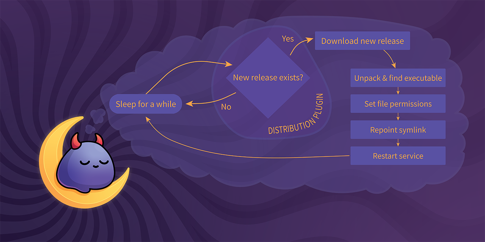
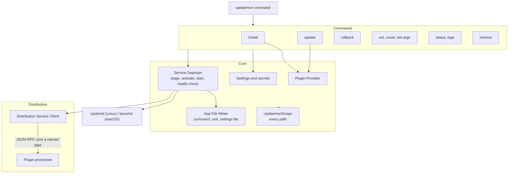
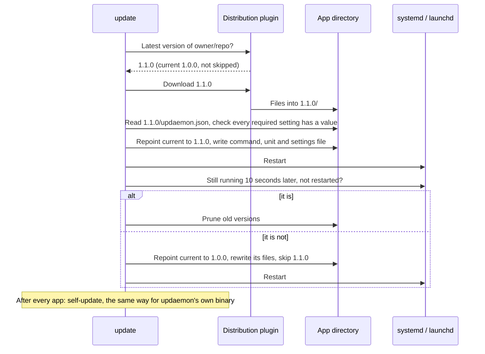
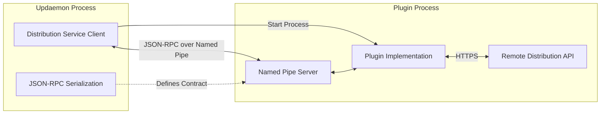
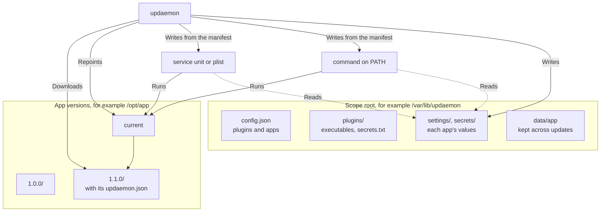
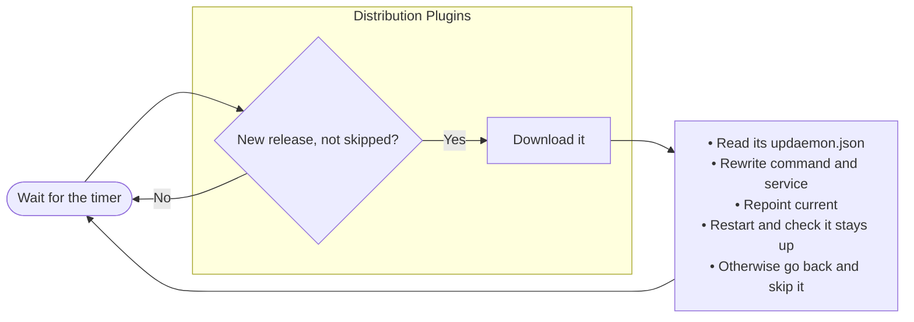

<div align="center">
  
</div>

# Updaemon

[](https://github.com/AdamTovatt/updaemon/actions/workflows/dotnet.yml)

**Updaemon installs apps and services from their releases and keeps them up to date, on Linux and macOS.**

`updaemon install byteshelf --from github:owner/byteshelf` downloads the latest release, reads its `updaemon.json`, asks for any setting it needs, puts its command on PATH and starts its service: a systemd unit on Linux, a launchd job on macOS. `updaemon update` then installs each new release, checks that the service keeps running, and goes back to the previous version if it does not.

<div align="center">
  
</div>

## Features

- **Updates on a schedule**: `updaemon timer 1h` checks for new releases every hour, of your apps and of updaemon itself.
- **Health check and rollback**: a service that does not keep running after an update goes back to the previous version, and the failed version is skipped. `updaemon rollback` goes back by hand.
- **Settings and secrets**: a release declares the settings it needs; updaemon asks for them and keeps secrets in a file only the owner can read.
- **Any release source**: GitHub releases out of the box; distribution plugins add other sources.
- **System-wide or per user**: run as root for system services, or as yourself for your own.
- **One native binary**: nothing else to install.

## Publishing with Updaemon

To make your releases installable, see [PublishingWithUpdaemon.md](PublishingWithUpdaemon.md). It describes `updaemon.json`, settings, and what updaemon does with them.

## Table of Contents

**Getting Started:**
- [Installing Updaemon](#installation)
- [Installing an app](#installing-an-app)
- [System-wide or per user](#system-wide-or-per-user)
- [Upgrading from 0.x](#upgrading-from-0x)

**User Guide:**
- [CLI Commands](#cli-commands)
- [Configuration](#configuration)

**For Developers:**
- [Creating Distribution Plugins](#creating-distribution-plugins)
- [System Architecture](#system-architecture)
- [Architecture Decisions](#architecture-decisions)

## Getting Started

### Installation

> [!NOTE]
> Updaemon is still in early and active development. Commands and ways of doing things could change.
> Don't hesitate to reach out if there is a specific feature you think is missing.

For system-wide apps:

```bash
curl -fsSL https://raw.githubusercontent.com/AdamTovatt/updaemon/master/install.sh | sudo bash
```

For your own apps only, without root:

```bash
curl -fsSL https://raw.githubusercontent.com/AdamTovatt/updaemon/master/install.sh | bash
```

The script installs the latest release for this machine and links the `updaemon` command to it: `/usr/local/bin/updaemon` system-wide, `~/.local/bin/updaemon` for you. From then on, `updaemon update` keeps updaemon itself up to date too (see [self-update](#self-update)). Running the script again does no harm.

`updaemon help` lists the commands, `updaemon help <command>` explains one, and `updaemon --version` prints the version.

### Installing an app

```bash
sudo updaemon install byteshelf --from github:owner/byteshelf
```

`--from` names the distribution plugin and what that plugin calls the app; for GitHub, that is `owner/repo`. A plugin from updaemon's registry, such as `github`, is installed the first time an app needs it. Give settings up front with `--set KEY=VALUE`; `install` asks for any required setting that is still missing.

A release without `updaemon.json` can still be installed: `--command <name>` puts its executable on PATH under that name, and `--service` runs it as a service.

Some plugins need secrets, for example a GitHub token for private repositories or to avoid rate limits:

```bash
sudo updaemon secret-set github githubToken <token>
```

### System-wide or per user

Who runs updaemon decides which apps it manages. As root, it manages system-wide apps. As anyone else, it manages that user's own apps, kept apart from the system's and from other users'. Every command works the same either way, and `updaemon status` names the scope.

| | System, Linux | System, macOS | User, Linux | User, macOS |
| --- | --- | --- | --- | --- |
| Config, secrets, plugins, app data | `/var/lib/updaemon` | `/usr/local/var/updaemon` | `~/.local/share/updaemon` | `~/Library/Application Support/updaemon` |
| App versions | `/opt/<app>` | `/usr/local/opt/<app>` | `apps/<app>` under the above | `apps/<app>` under the above |
| Commands | `/usr/local/bin` | `/usr/local/bin` | `~/.local/bin` | `~/.local/bin` |
| Services | `/etc/systemd/system` | `/Library/LaunchDaemons` | `~/.config/systemd/user` | `~/Library/LaunchAgents` |
| Service logs | the journal | `/var/log/updaemon` | the journal | `~/Library/Logs/updaemon` |

On Linux, `$XDG_DATA_HOME` and `$XDG_CONFIG_HOME` move the user paths when set.

A system-wide service runs as root unless installed with `--run-as <user>`. A user's services run as that user. On Linux they run only while the user is logged in, unless lingering is on for that user (`sudo loginctl enable-linger <user>`); updaemon does not turn it on for you.

### Upgrading from 0.x

Updaemon 1.0 does not read a 0.x setup; reinstall the apps instead. For each app 0.x installed, stop and remove its service, then delete its versions:

```bash
sudo systemctl disable --now my-api
sudo rm /etc/systemd/system/my-api.service
sudo systemctl daemon-reload
sudo rm -r /opt/my-api
```

On macOS, unload `/Library/LaunchDaemons/com.updaemon.my-api.plist` with `sudo launchctl bootout system/com.updaemon.my-api`, then delete it and `/usr/local/opt/my-api`.

Then install updaemon 1.0 over 0.x, move the old config aside and install the apps again:

```bash
curl -fsSL https://raw.githubusercontent.com/AdamTovatt/updaemon/master/install.sh | sudo bash
sudo mv /var/lib/updaemon/config.json /var/lib/updaemon/config.0x.json
sudo updaemon install my-api --from github:owner/my-api
```

Until the old config is moved, every command that reads it stops and says so. `install` refuses a name that already has a service, so a missed unit is reported rather than overwritten.

## CLI Commands

An argument in angle brackets (`< >`) is required; one in square brackets (`[ ]`) is optional. `[app]` means one app, or every app when left out. Use `sudo` for system-wide apps and leave it out for your own.

| Command | Description |
| --- | --- |
| [install](#install) | Install an app from a distribution plugin. |
| [update](#update) | Update every app and updaemon itself, or one app. |
| [rollback](#rollback) | Go back to an earlier version of an app. |
| [status](#status) | Show the apps, their versions and whether they run. |
| [logs](#logs) | Show an app's service log. |
| [set, unset](#set-and-unset) | Change an app's settings. |
| [set-args](#set-args) | Change the arguments a service runs with. |
| [set-restart](#set-restart) | Choose whether `update` restarts a service. |
| [remove](#remove) | Remove an app. |
| [timer](#timer) | Check for updates on a schedule. |
| [self-update](#self-update) | Turn updaemon's own updates on or off. |
| [dist-install](#dist-install) | Install a distribution plugin. |
| [dist-list](#dist-list) | List the installed plugins. |
| [secret-set](#secret-set) | Set a secret for a plugin. |
| help | `updaemon help [command]` shows help, and the version. |

### install

```bash
updaemon install <app> --from <plugin>:<remote> [--set KEY=VALUE]... [--command <name>] [--service] [--run-as <user>]
```

Downloads the latest release, reads its `updaemon.json`, asks for each required setting without a value, writes the app's command and service, and starts the service. `<app>` is the local name: the app's directory, service and data directory are named after it.

A service must keep running for 10 seconds after it starts. If it does not, the app stays installed and `install` fails, pointing to `updaemon logs <app>`.

```bash
sudo updaemon install byteshelf --from github:owner/byteshelf --set BYTESHELF_URL=https://shelf.example
updaemon install mytool --from github:me/mytool --command mytool
```

### update

```bash
updaemon update [app]
```

Installs each app's latest release. The new release's `updaemon.json` is read again, so a release can add settings or change its arguments. If it needs a setting the app has no value for, the current version keeps running and the message names the `updaemon set` command to run.

A restarted service must keep running for 10 seconds. If it does not, the previous version runs again, `update` fails pointing to `updaemon logs <app>`, and the new version is skipped: later updates pass over it until a newer release appears. `updaemon status` lists skipped versions.

After an update, old versions are deleted down to `releaseRetentionCount` in `config.json` (5 by default). The current version is always kept.

Without an app named, `update` ends by updating updaemon itself; see [self-update](#self-update).

### rollback

```bash
updaemon rollback <app> [version]
```

Makes an earlier kept version current again: the newest one older than the current version that is not skipped, or the version named. It rebuilds the app's command and service from that version's `updaemon.json`, checks it has every setting it needs, and restarts the service. The version rolled back from is skipped, so `update` does not install it again.

Naming a newer kept version switches forward to it, for example to undo a rollback.

### status

```bash
updaemon status [app]
```

Shows updaemon's version, its scope, the update timer and whether self-update is on, then one line per app: version, whether it is a command, a service or both, whether the service runs, where it comes from, and any skipped versions.

### logs

```bash
updaemon logs <app> [-f]
```

Shows the last 100 lines of the app's service log: its journal on Linux, its log files on macOS. With `-f`, keeps showing new lines until Ctrl+C. A command writes to the terminal that runs it, so only services have a log.

### set and unset

```bash
updaemon set <app> KEY=VALUE... [--secret]
updaemon unset <app> KEY...
```

Changes the app's settings and restarts its service if it runs. A setting the app's `updaemon.json` declares secret is stored as a secret; `--secret` does the same for one it does not declare. A required setting cannot be unset.

### set-args

```bash
updaemon set-args <app> [-- args...]
```

Sets the arguments the service runs with, in place of the ones in its `updaemon.json`. Without `--`, goes back to those.

### set-restart

```bash
updaemon set-restart <app> auto|manual
```

With `manual`, `update` installs a new version but leaves the running service alone; it runs the new version when it next restarts. Useful for an app that applies updates on its own schedule. `auto`, the default, restarts it.

### remove

```bash
updaemon remove <app> [--purge]
```

Stops and deletes the app's service, its command, all its versions, its settings and its secrets. Its data directory is kept unless `--purge` is given.

### timer

```bash
updaemon timer [interval]
```

Runs `updaemon update` every `interval` (`30s`, `10m`, `1h`): a systemd timer on Linux, a launchd job on macOS. Without an interval, shows the current one; `-` turns it off.

### self-update

```bash
updaemon self-update [on|off]
```

When on, the default, `updaemon update` ends by updating updaemon to its latest release. The new version is downloaded into its own directory, beside the one running, and must run (`updaemon --version`) before the `updaemon` command is switched to it in one step. If anything fails, the running version stays and `update` reports why. The previous version is kept until the next self-update.

Registry plugins always come from the release of the updaemon that runs them: the first install or update after a self-update reinstalls them from the new release. If that fails, the apps using that plugin fail with the reason, and the installed plugin is kept. Plugins installed from a URL are not updated; reinstall them with `dist-install` if a new updaemon needs a newer build.

Self-update replaces only the scope's own `updaemon` command. Running the system-wide updaemon as another user skips it, and says so.

Without an argument, shows whether self-update is on.

### dist-install

```bash
updaemon dist-install [--as <alias>] <plugin-name|url>
```

Installs a distribution plugin by registry name or from a URL. A registry plugin comes from the release of the updaemon you run, built for your machine. Releases carry builds for `linux-arm64` and `osx-arm64`; on another platform, build the plugin and install it from its URL. `install` already installs a missing registry plugin, so this is mostly for URL plugins and aliases.

A plugin already installed under the alias is replaced, but only once the new one has started and answered.

### dist-list

```bash
updaemon dist-list
```

Lists the installed plugins with their version, description and secrets.

### secret-set

```bash
updaemon secret-set <plugin-alias> <key> <value>
```

Sets a secret for a plugin, such as `githubToken` for `github`.

[↑ Back to top](#updaemon)

## Configuration

Everything updaemon keeps for a scope lives under its root directory (see [System-wide or per user](#system-wide-or-per-user)):

```
config.json            installed plugins and apps
versions/<version>/    updaemon itself; the updaemon command links to one
plugins/<alias>/       each plugin's executable and secrets.txt
settings/<app>.env     each app's settings, readable by everyone
secrets/<app>.env      each app's secrets, readable by the owner only
data/<app>/            each app's data, kept across updates; passed as UPDAEMON_DATA_DIR
```

Each app's versions sit next to a `current` link to the one that runs:

```
/opt/my-api/
├── 1.0.0/
├── 1.1.0/
└── current -> 1.1.0
```

### config.json

Updaemon writes this file; the commands above change it. One setting is meant for editing by hand: `releaseRetentionCount`, how many versions of each app to keep (5 by default).

```json
{
  "format": 1,
  "installedPlugins": {
    "github": {
      "alias": "github",
      "path": "/var/lib/updaemon/plugins/github/Updaemon.GithubDistributionService",
      "source": { "kind": "registry", "name": "github", "release": "1.0.0" }
    }
  },
  "apps": [
    {
      "name": "byteshelf",
      "plugin": "github",
      "remote": "owner/byteshelf",
      "settings": { "BYTESHELF_URL": "https://shelf.example" },
      "autoRestart": true,
      "skippedVersions": [ "1.4.0" ]
    }
  ],
  "releaseRetentionCount": 5,
  "selfUpdate": true
}
```

`skippedVersions` lists the versions `update` passes over: each failed its health check or was rolled back from. A registry plugin's `release` is the updaemon release it came from. `selfUpdate` is what `updaemon self-update on|off` sets.

[↑ Back to top](#updaemon)

## Creating Distribution Plugins

Distribution plugins are separate AOT-compiled executables that communicate with updaemon via named pipes using a JSON-RPC protocol. The contract is defined in the separate **Updaemon.Common** project.

### Quick Start

1. **Reference Updaemon.Common** in your plugin project.

2. **Implement IDistributionService**:
   ```csharp
   using Updaemon.Common;
   
   public class MyDistributionService : IDistributionService
   {
       public DistributionServiceInformation GetServiceInformation() { /* ... */ }
       public Task InitializeAsync(SecretCollection secrets, CancellationToken cancellationToken = default) { /* ... */ }
       public Task<Version?> GetLatestVersionAsync(string serviceName, CancellationToken cancellationToken = default) { /* ... */ }
       public Task DownloadVersionAsync(string serviceName, Version version, string runtimeIdentifier, string targetPath, CancellationToken cancellationToken = default) { /* ... */ }
   }
   ```

3. **Host using DistributionServiceHost**:
   ```csharp
   using Updaemon.Common.Hosting;
   
   class Program
   {
       static async Task Main(string[] args)
       {
           await DistributionServiceHost.RunAsync(args, new MyDistributionService());
       }
   }
   ```

That's it! The `DistributionServiceHost` handles all the named pipe server infrastructure, argument parsing, RPC routing, and error handling automatically.

For detailed instructions and advanced options, see [Updaemon.Common/README.md](Updaemon.Common/README.md).

### Plugin Requirements

1. Reference the **Updaemon.Common** project or NuGet package
2. Implement the `IDistributionService` interface from `Updaemon.Common`
3. Accept `--pipe-name <name>` command-line argument
4. Host a named pipe server that handles JSON-RPC requests
5. Use `CommonJsonContext` for RPC serialization (AOT-compatible)
6. Be compiled as an AOT executable for the target platform (linux-arm64, linux-x64, or osx-arm64)

### RPC Protocol

The RPC types (`RpcRequest` and `RpcResponse`) are defined in `Updaemon.Common.Rpc`:

**Request:**
```json
{
  "id": "unique-request-id",
  "method": "GetLatestVersionAsync",
  "parameters": "\"MyApp\""
}
```

`DownloadVersionAsync` takes an object: `"{\"serviceName\":\"MyApp\",\"version\":\"1.2.3\",\"runtimeIdentifier\":\"linux-arm64\",\"targetPath\":\"/opt/my-app/1.2.3\"}"`.

**Response:**
```json
{
  "id": "unique-request-id",
  "success": true,
  "result": "\"1.2.3\"",
  "error": null
}
```

**Important:** Use `Updaemon.Common.Serialization.CommonJsonContext` for serializing/deserializing RPC messages to ensure AOT compatibility.

[↑ Back to top](#updaemon)

## Architecture Decisions

### Why a Separate Common Project?

The **Updaemon.Common** project contains only the shared code between updaemon and distribution plugins:
- `IDistributionService` interface
- RPC message types (`RpcRequest`, `RpcResponse`)
- JSON serialization context for AOT compatibility
- Utility classes (e.g., `DownloadPostProcessor` for archive extraction)

**Benefits:**
- **Clean separation**: Plugin authors only reference what they need, not updaemon's entire codebase
- **Clear versioning**: The common library can be versioned independently
- **Reduced coupling**: Internal updaemon changes don't affect plugin authors
- **NuGet distribution**: Can be published as a standalone package for easy consumption
- **Better testing**: Plugins can test against a stable, minimal library
- **Shared utilities**: Common functionality like archive extraction can be reused across plugins

Without this separation, plugin authors would either need to reference the entire Updaemon project (pulling in unnecessary dependencies like command handlers, config managers, etc.) or manually recreate the interface definitions and utilities (risking version drift and errors).

### Why AOT Compilation?

Updaemon uses AOT (Ahead-of-Time) compilation instead of traditional JIT (Just-in-Time) compilation for several key reasons:

- **Lightning fast startup time**: As a one shot CLI tool that runs frequently (potentially on every update check), AOT provides near-instant startup with no JIT warmup overhead
- **Single executable deployment**: The entire application compiles to a single native binary, making installation as simple as copying one file
- **No runtime dependencies**: Target systems don't need the .NET runtime installed, reducing deployment complexity and system requirements
- **Lower memory footprint**: AOT binaries use less memory than JIT-compiled applications, important for a background service

### Why Pluggable Distribution Services?

Updaemon uses a plugin architecture for distribution services to maintain true flexibility:

- **Support diverse distribution methods**: Different organizations use different distribution systems (custom file servers, cloud storage, package registries, etc.)
- **No vendor lock-in**: Users can implement their own distribution service without modifying updaemon's core
- **Evolution over time**: New distribution methods can be added as they emerge without updating updaemon itself
- **Custom authentication**: Each plugin can handle its own authentication mechanisms (API keys, OAuth, certificates, etc.)

By separating service management and update decisions (updaemon core) from file acquisition and retrieval (distribution plugins), the system remains adaptable to any deployment workflow.

### Why Named Pipes with JSON-RPC Instead of DLL Plugins?

AOT compilation doesn't support dynamic assembly loading at runtime. Named pipes with JSON-RPC allow us to:
- Keep plugins as separate processes
- Maintain AOT compatibility (using System.Text.Json source generation)
- Isolate plugin failures from updaemon
- Support plugins written in any language
- Human-readable messages for debugging

### Why System.Version?

Using `System.Version` provides:
- Standardized semantic versioning
- Built-in comparison operators
- Clear contract between updaemon and plugins

### Why Symlinks?

Symlinks enable:
- Zero-downtime deployments
- Rollback by repointing the link (`updaemon rollback`)
- Multiple versions coexisting on disk
- Atomic version switching

### Why a Separate Service Manager Implementation per OS?

Linux services are managed by systemd via `systemctl` and `.service` unit files under `/etc/systemd/system/`. macOS services are managed by launchd via `launchctl` and `.plist` LaunchDaemon files under `/Library/LaunchDaemons/`. The two systems have similar concepts (start, stop, enable, periodic timer, log capture) but completely different command lines, file formats, and mental models; no realistic shim papers over them cleanly.

Updaemon hides this difference behind three interfaces, `IServiceManager`, `ITimerManager` and `IUnitFileManager`, with a Linux implementation backed by systemd and a macOS implementation backed by launchd. `Program.cs` picks the right concrete classes at startup based on `OperatingSystem.IsMacOS()`. Every path (config, app versions, commands, units, logs) comes from one `UpdaemonScope`, chosen at startup for the platform and for system or user, so each call site stays OS-agnostic.

**Benefits:**
- Command code (`InstallCommand`, `UpdateCommand`, `TimerCommand`, etc.) doesn't branch on the platform.
- Adding a new OS means writing three small classes and its paths in `UpdaemonScope`, with no changes to the call sites.
- Tests run cleanly on either OS because the interfaces are mockable.

**Trade-off:** there's some duplication between the two timer implementations (one writes a `.service` + `.timer` pair with `OnCalendar`, the other writes a single plist with `StartInterval`). That duplication is intrinsic to the underlying system contracts, not avoidable at the .NET layer.

[↑ Back to top](#updaemon)

## System Architecture



[↑ Back to top](#updaemon)

## Update Flow



[↑ Back to top](#updaemon)

## Plugin Communication Architecture



[↑ Back to top](#updaemon)

## File System Data Flow



[↑ Back to top](#updaemon)

## High Level Overview



[↑ Back to top](#updaemon)

## License

MIT

